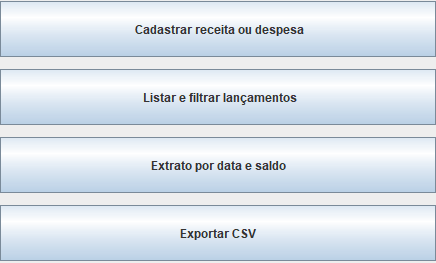
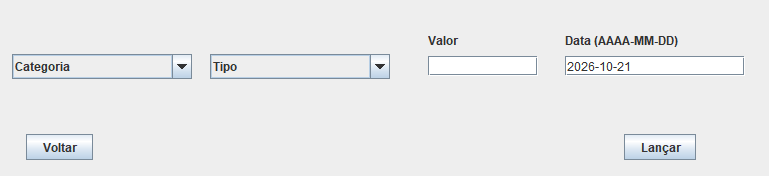
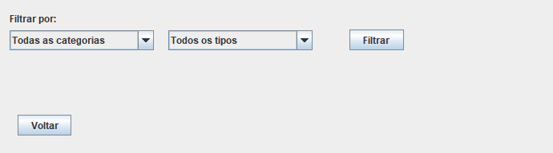

# Gerenciador de finanças pessoais

Aplicativo desktop Swing para registrar receitas e despesas, consultar por categoria e tipo, visualizar extrato por data e exportar CSV.





## Executar e testar

Requisitos: JDK 17 ou superior com `java` e `javac` disponíveis no PATH, e PowerShell. Sem bibliotecas externas.

Na pasta deste projeto:

```powershell
.\build.ps1 -Test
.\build.ps1 -Run
```

`-Test` compila fontes e testes com UTF-8, todos os avisos habilitados e avisos tratados como erro. Os testes usam um programa Java de regressão, sem depender de JUnit ou downloads. Os arquivos de teste ficam em `build/`, ignorado pelo Git.

Os parâmetros `-Test` e `-Run` também podem ser usados juntos. A pasta `src/` contém o programa e `tests/` contém as verificações. Cada pasta de projeto pode virar um repositório independente.

## Dados e configuração

Na primeira execução pelo caminho padrão, `data/exemplo.csv` é copiado para `data/lancamentos.csv`. O exemplo contém somente dados fictícios. O arquivo de uso fica fora do versionamento. As execuções seguintes mantêm os dados cadastrados.

Formato: uma linha por lançamento, sem cabeçalho, com quatro campos separados por ponto e vírgula:

```text
RECEITA;SALARIO;2026-01-05;3000.00
DESPESA;ALIMENTACAO;2026-01-06;125.50
```

Datas usam `AAAA-MM-DD`. No CSV, valores usam ponto decimal; a tela aceita ponto ou vírgula, sem separador de milhares. Valores devem ser positivos e ter no máximo duas casas decimais. Categorias e tipos válidos estão nos enums em `src/enums/`.

Para escolher outro CSV já existente, após compilar:

```powershell
java '-Dfinanceiro.arquivo=data/minha-conta.csv' -cp build/classes Main
```

## Funcionamento

- Valores monetários usam `BigDecimal` e o saldo é calculado na classe `Conta`: saldo inicial mais receitas menos despesas. A interface usa saldo inicial zero.
- Ordenar o extrato não altera a conta nem soma lançamentos novamente.
- Filtro sem resultados retorna uma lista vazia, exibida como mensagem na interface.
- Campos CSV inválidos interrompem a leitura com o número da linha; não são descartados silenciosamente. Linhas em branco são ignoradas.
- Uma falha de leitura impede o cadastro. Uma gravação usa arquivo temporário e substituição atômica; se o sistema de arquivos não suportar a operação, o original é preservado e a gravação é recusada.
- Exportar não substitui um arquivo já existente; escolha um nome novo.
- `Lancamento` é imutável e não herda de `Conta`.

## Testes e limites

A suíte cobre precisão decimal, saldo, ordenação sem efeito colateral, filtros, persistência, exportação e preservação de arquivos ausentes ou inválidos. As três telas foram instanciadas e renderizadas para conferir o layout; as imagens acima vêm do próprio aplicativo.

Projeto local para uma instância por arquivo, sem controle de acesso simultâneo entre processos. Não há banco de dados, edição ou exclusão de lançamentos. Executar a interface exige ambiente gráfico. Os testes principais funcionam sem interface gráfica.

## Autor

Daniel — [Danielloes](https://github.com/Danielloes).
